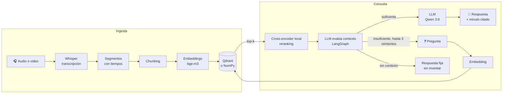

# 🎧 ¿Cómo enseñarle a una IA a escuchar?

Un sistema **RAG sobre audio y video**, escrito con código propio y simple, para
entender cada pieza: le haces una pregunta a un archivo y te responde **citando
el minuto exacto**, con un reproductor que salta a ese momento.



## Arquitectura

| Pieza | Por defecto (local) | Alternativa en la nube | Dónde corre |
|---|---|---|---|
| Transcripción | Whisper `large-v3-turbo` (faster-whisper) | API de OpenAI o Groq | Docker (o nativo con MLX en Mac) |
| Embeddings | `bge-m3` vía Ollama | `text-embedding-3-small` | Ollama nativo |
| Base vectorial | Qdrant | Qdrant Cloud · o NumPy (a mano) | Docker |
| LLM | `qwen3.8:27b` vía Ollama | OpenRouter, OpenAI… | Ollama nativo |
| Reranker | `cross-encoder/mmarco-mMiniLMv2-L12-H384-v1` (multilingüe, compacto) | Configurable por `RERANKER_MODEL` | Docker (CPU, caché Hugging Face) |
| Orquestación | LangGraph: evaluación y hasta 3 reintentos | — | Docker |
| Interfaz | Gradio | — | Docker |

**¿Por qué Ollama no está en Docker?** En macOS, Docker no tiene acceso a la GPU
del Mac. Un modelo de 27B en CPU sería inutilizable, así que Ollama corre nativo
y los contenedores lo alcanzan en `host.docker.internal`. En Linux con GPU NVIDIA
sí puedes levantarlo en Docker (`docker compose --profile ollama up -d`).

## Cómo correrlo

Requisitos: Docker y [Ollama](https://ollama.com).

```bash
cp .env.example .env              # o: make env
ollama pull bge-m3                # embeddings
ollama pull <tu-modelo>           # y ajusta LLM_MODEL en .env
make up                           # Qdrant + app en Docker
```

1. Copia tu audio (por ejemplo MP3) o video a `data/videos/`.
2. Abre http://localhost:7860, pestaña **1 · Ingesta**, elige el archivo y pulsa
   *Transcribir e indexar*.
3. En **2 · Preguntar**, haz tu pregunta. Activa *Comparar con respuesta SIN RAG*
   para ver qué responde el modelo sin el contexto de la transcripción.

El archivo de conversación incluido `data/videos/floristeria.mp3` aparece en el
desplegable y se procesa igual que un video. También puedes indexarlo desde la
terminal con `make ingest VIDEO=floristeria.mp3`.

`make help` lista todos los atajos. `make check` verifica que todo responda.

### Transcribir más rápido en un Mac con Apple Silicon

Dentro de Docker, Whisper corre en CPU. Para usar la GPU del Mac:

```bash
brew install ffmpeg
make mac-setup                          # entorno nativo con mlx-whisper
make transcribe-mac VIDEO=noticia.mp4   # deja la transcripción en data/transcripts/
# También acepta audio, por ejemplo:
make transcribe-mac VIDEO=floristeria.mp3
```

La app detecta la transcripción en caché y salta directo al chunking.

### Usar servicios en la nube

No hay que tocar código: todos los componentes hablan con **APIs compatibles con
OpenAI**. Cambia la URL, la clave y el modelo en `.env` (hay ejemplos al final de
`.env.example`). Si cambias el modelo de embeddings, **vuelve a indexar**: cada
modelo usa su propia colección.

### Qdrant o NumPy

`VECTOR_STORE=numpy` reemplaza Qdrant por una búsqueda hecha a mano en
`rag/store.py` (~30 líneas): normalizar, producto punto, ordenar. Es lo mismo que
hace Qdrant, solo que Qdrant usa un índice (HNSW) para no comparar contra todos
los vectores, filtra por metadatos y escala a millones de chunks.

### Flujo de consulta adaptativo

La búsqueda vectorial obtiene `TOP_K` candidatos y un cross-encoder local los
reordena comparando pregunta y fragmento conjuntamente. LangGraph pide al LLM
evaluar si el contexto basta para responder; si no, devuelve en la misma llamada
una consulta reformulada, corrigiendo posibles errores de escritura, y vuelve a
buscar hasta `MAX_QUERY_RETRIES` veces (3 por defecto, cuatro búsquedas
como máximo contando la inicial). Si sigue sin evidencia, responde
**«Eso no se dice en el video.»**. Modelo y límite se pueden cambiar con
`RERANKER_MODEL` y `MAX_QUERY_RETRIES` en `.env`. El modelo se descarga al primer
uso y queda en la caché persistente de Hugging Face de Docker.

## Mapa del código

| Archivo | Etapa |
|---|---|
| `rag/transcribe.py` | 1 · Audio/video → segmentos con tiempos (Whisper) |
| `rag/chunking.py` | 2 · Segmentos → chunks |
| `rag/embeddings.py` | 3 · Texto → vectores |
| `rag/store.py` | 4 · Guardar y buscar vectores (NumPy y Qdrant) |
| `rag/rerank.py` | 5 · Reordenar candidatos con cross-encoder local |
| `rag/query_graph.py` | 6 · Evaluar contexto y controlar reintentos (LangGraph) |
| `rag/llm.py` | 7 · Prompt con contexto → respuesta con citas |
| `rag/pipeline.py` | Todo junto (también como CLI) |
| `app.py` | Interfaz Gradio |
| `docs/retos.md` | Ejercicios con solución |

### ¿Y LangChain o LlamaIndex?

Hacen lo mismo con menos líneas, pero esconden justo lo que aquí queremos ver.
Una vez entiendes las piezas, el mapa es directo:

| Aquí | LangChain | LlamaIndex |
|---|---|---|
| `transcribe()` | `YoutubeLoader` / loaders de audio | `VideoAudioReader` / readers de audio |
| `chunk_segments()` | `RecursiveCharacterTextSplitter` | `SentenceSplitter` |
| `Embedder` | `OpenAIEmbeddings` / `OllamaEmbeddings` | `OllamaEmbedding` |
| `QdrantStore` | `QdrantVectorStore` | `QdrantVectorStore` |
| `RAG.retrieve()` | `vectorstore.as_retriever()` | `index.as_retriever()` |
| `build_messages()` + `LLM` | `create_retrieval_chain` | `index.as_query_engine()` |

## Pruebas

```bash
make test        # dentro de Docker; no necesitan Ollama ni red
```

## Retos

Después de la charla: [`docs/retos.md`](docs/retos.md).
